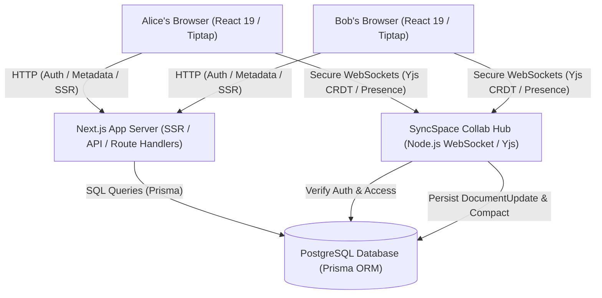

# SyncSpace — Architecture Documentation

## 1. System Overview

SyncSpace is a multi-tenant, real-time collaborative document platform engineered using modern web technologies: Next.js (App Router), React 19, TypeScript, Tailwind CSS, PostgreSQL, Prisma ORM, and Yjs CRDTs with WebSockets.

The architecture emphasizes:
- **Server-First Execution:** Server Components for read-heavy operations, Route Handlers and Server Actions for sensitive business operations.
- **Zero-Trust Access Control:** Centralized domain authorization policies rejecting unauthorized requests by default.
- **Conflict-Free Convergence:** Yjs YATA CRDT data structure guarantees deterministic convergence across concurrent clients without locks.
- **Durable Persistence:** Streaming incremental binary updates buffered to PostgreSQL, accompanied by periodic snapshot compaction.

---

## 2. Component Topology

---

## 3. Real-Time Collaboration Pipeline

1. **Connection Handshake:**
   - The client browser initiates a connection to `ws://localhost:3001?docId=<documentId>`.
   - Authentication is performed through either an explicit signed JWT query parameter or the HttpOnly `syncspace_session` cookie header.
   - The collaboration hub executes `getDocumentAccess(userId, docId, shareToken)` against PostgreSQL.
   - If unauthorized, the connection closes immediately with code `1008` (Policy Violation).
   - If granted with role `VIEWER`, the client is flagged `isReadOnly = true` (disallowing write mutations).

2. **Synchronization Handshake:**
   - The hub creates or retrieves the in-memory `Room` associated with `docId`.
   - The hub transmits `SyncStep1` containing the state vector of the server document.
   - The client responds with `SyncStep2` emitting missing changes.
   - The hub sends missing updates back to the client.

3. **Presence Awareness:**
   - Cursors, text selections, and user metadata (name, color, avatarUrl) are exchanged over the `awareness` protocol channel (`messageAwareness`).
   - Awareness states are ephemeral and broadcast in real time to connected peers in the same document room.

4. **Persistence & Compaction:**
   - Client keystrokes emit incremental Yjs binary updates (`Uint8Array`).
   - The hub validates read-write permissions, broadcasts to room peers, and inserts a `DocumentUpdate` row into PostgreSQL.
   - When accumulated updates exceed 50 entries, `compactRoomUpdates` executes:
     - Encodes the entire `Y.Doc` state as a single compressed update.
     - Replaces older incremental updates in an atomic Prisma transaction.

---

## 4. Authentication & Session Strategy

- **Stateless Verified Sessions:**
  - Sessions are managed using JSON Web Tokens (JWT) signed with HMAC-SHA256 (`HS256`) via the `jose` library.
  - Stored in an `HttpOnly`, `SameSite=Lax`, `Secure` cookie named `syncspace_session`.
  - Avoids database round-trips for high-throughput static asset and page routing.
- **Password Security:**
  - Password hashing employs `bcryptjs` with 12 salt rounds, ensuring resistance to dictionary and rainbow-table attacks.
- **Audit Trail:**
  - Key lifecycle actions (`AUTH_SIGN_IN`, `DOCUMENT_CREATE`, `VERSION_RESTORE`, `COMMENT_RESOLVE`) are durably recorded in the `AuditEvent` table with sensitive payloads automatically redacted.

---

## 5. Architectural Trade-offs & Decisions

| Decision | Chosen Approach | Alternative Considered | Rationale |
|---|---|---|---|
| **Concurrency Strategy** | Yjs CRDTs | Operational Transformation (OT) or Last-Write-Wins | CRDTs eliminate the need for centralized operational sequence transformation and work natively with offline/partitioned networks. |
| **Collab Hosting** | Dedicated WebSocket Server Adapter | Next.js Serverless Route Handlers | Serverless execution environments terminate long-lived TCP/WebSocket connections. A dedicated collaboration service guarantees persistent awareness and bounded latency. |
| **Theme Management** | Semantic CSS Variables + next-themes | Tailwind hard-coded utility classes | Eliminates theme flicker, supports system OS preference, and adapts all editor primitives seamlessly. |
| **Database Engine** | PostgreSQL with embedded runner | SQLite | PostgreSQL guarantees strict ACID transactions, JSON/Bytes support for CRDT updates, and production compatibility with cloud providers like Neon and Supabase. |
